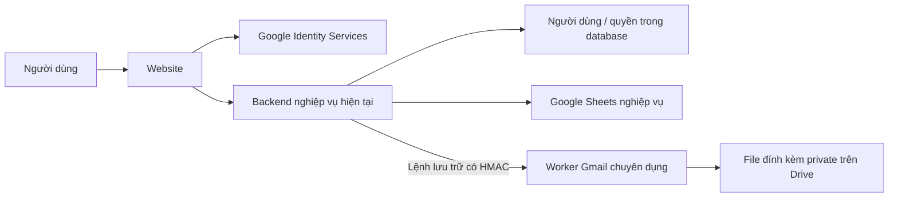

# Kiến trúc bảo mật hiện hành

Cập nhật: **27/10/2026**. Backend `1.11.20-sla-holds` đã được người dùng xác nhận deploy; số deployment version mới chưa được cung cấp. Frontend liveJS162/entry143 phát hành qua main sau backend. Xem [PRODUCTION-STATE.md](PRODUCTION-STATE.md) để phân biệt xác nhận triển khai, kiểm thử local và thử dữ liệu thật.

## Ranh giới tin cậy

Website GitHub Pages và URL Apps Script là công khai. Ẩn menu không cấp hoặc thu hồi quyền. API xác thực và kiểm tra role/center/phạm vi hồ sơ tại server trước khi đọc hoặc ghi.

Chỉ backend chính quyết định quyền nghiệp vụ. Worker không nhận portal token, không cần quyền database/quản lý center hay Cloud Owner và không thực hiện lưu công việc/KPI.

## Xác thực và phiên

- Google ID token được kiểm tra `aud`, `iss`, `exp`, `email_verified` và `sub`; client không tự cung cấp actor đáng tin cậy.
- Tab `Người dùng` là nguồn quyền, gồm trạng thái hoạt động và center. Không dùng `USERS_JSON` làm registry hiện hành.
- `PortalSessions.gs` đổi credential Google còn hợp lệ thành phiên portal tuyệt đối8giờ; lưu hash token trong Script Properties. Retry không kéo dài hạn, không dùng phiên cũ để cấp phiên mới.
- Phiên portal đọc lại quyền hiện hành; user bị tắt, đổi center/role hoặc GoogleSub không khớp bị xử lý tại server. Đăng xuất để lại trạng thái thu hồi chống phản hồi cũ khôi phục phiên.
- Không đưa token vào URL, audit, log, Git hoặc dữ liệu Sheet. Không reset Script Properties để xử lý upload hoặc đồng bộ mã nguồn.

## Vai trò và capability

| Nhóm | Phạm vi chính |
|---|---|
| `service_manager` gốc | Quản lý toàn hệ thống; sửa nguồn mọi loại thiết bị và xóa mềm cả hồ sơ hoàn tất/đã duyệt theo guard hiện hành |
| `center_manager` tại đúng Sungrow Service Center | Quản lý toàn cục và sửa nguồn như quyền hiện hành; không tự có capability xóa mở rộng của vai trò hệ thống gốc |
| `center_manager` khác | Nghiệp vụ trong center được cấp, không sửa nguồn không giới hạn |
| `center_staff` | Theo center được cấp; tiếp nhận/cập nhật/nhận luân chuyển/giao trả khi hồ sơ đủ điều kiện, không chủ động tạo luân chuyển |

`center_editor` là alias nhập liệu cũ được chuẩn hóa về `center_staff`, không phải vai trò thứ tư. Khả năng sửa nguồn dùng `canCorrectCaseSources`; quyền xóa mở rộng dùng `canDeleteAnyCase`, giữ nguồn vai trò trước khi nâng quản lý Sungrow. Không suy quyền xóa chỉ từ `isGlobalManager` hoặc role sau chuẩn hóa.

Center đang giữ hàng và trạng thái vận chuyển/công việc được kiểm tra lại trước giao trả/cập nhật. Center cũ không sửa tiếp chặng đã đóng. Hồ sơ hủy bị loại khỏi danh sách/KPI thông thường; backend có guard riêng cho truy cập quản lý.

## API và giao vận

- Dispatcher `handlePortalApi_` chỉ gọi các `functionName` trong allowlist, nhận `args` theo hợp đồng API hiện hành. Không dùng ví dụ `ticket.create`/`rowVersion` chung từ bản thiết kế cũ làm hợp đồng production.
- `apps-script-transport.js` dùng bridge iframe với origin/ancestor/channel được kiểm tra. Không đưa token vào URL để né lỗi giao vận.
- Không tự replay mutation khi chưa biết server đã ghi hay chưa. Tạo hồ sơ dùng requestId/receipt; Fan/correction dùng CAS/ledger/pending guards theo từng luồng.
- Khóa ScriptLock bảo vệ phần ghi nghiệp vụ. Drive/network I/O upload nằm ngoài khóa database dài.
- Audit ghi người thao tác thực; projection/index/revision đồng bộ sau ghi. Xóa là soft delete, không xóa bảng lịch sử.

## Kho đính kèm riêng

- Backend chính giữ danh tính thực thi hiện tại; worker chạy bằng `sungrowservicecenter@gmail.com`.
- Endpoint worker nhận được POST từ backend qua Internet; mọi lệnh yêu cầu HMAC SHA-256, nonce và timestamp5phút. Phản hồi cũng được ký và gắn nonce.
- Secret chỉ ở Script Properties; URL worker chỉ cấu hình phía server. Không đưa chúng vào frontend hoặc tài liệu/Git.
- Worker kiểm đúng tài khoản thực thi, root allowlist, parent/session, owner, kích thước và hash khi upload/recovery. Không mở API Drive tổng quát cho client.
- Upload có định danh để phục hồi mất phản hồi; không fallback âm thầm về email cũ. Dọn file tạm theo journal, bảo vệ file/folder đã thuộc hồ sơ canonical.
- Trang cấu hình `attachment_storage_setup=1` chỉ chủ backend hiện tại được dùng qua kiểm tra active/effective identity và nonce một lần10phút; merge đúng URL/secret, không tự bật mode hoặc reset thuộc tính khác. Hàm cấu hình không thuộc allowlist portal.
- File mới nhận owner mới; file cũ và liên kết cũ giữ nguyên. Quyền folder private vẫn phải được kiểm chứng trên Google thật.

## Dữ liệu trả về và cache

Response chỉ trả trường được role và phạm vi hồ sơ cho phép; không chia sẻ một response chứa PII toàn hệ thống cho mọi người dùng. Có thể dùng chung raw index/cache theo revision nhưng phải lọc quyền trước serialize response. Phiên Google, phiên portal, request nonce và biên nhận lưu trữ là những khái niệm riêng, không thay thế nhau.

Kiểm thử local bao gồm từ chối quyền, phiên hết hạn/thu hồi, gửi lặp, phạm vi center, property preservation, chữ ký/replay và cleanup. Các kiểm thử này không thay thế audit Cloud IAM, consent, quota, cấu hình folder thực tế hoặc kiểm thử tải production. Không tự thay các cấu hình đó chỉ vì đồng bộ repository.
